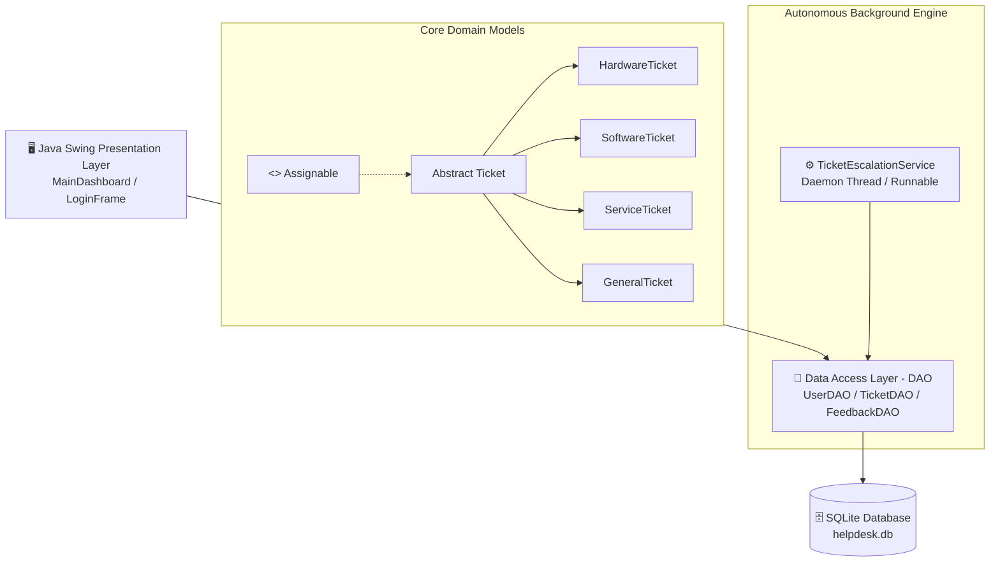
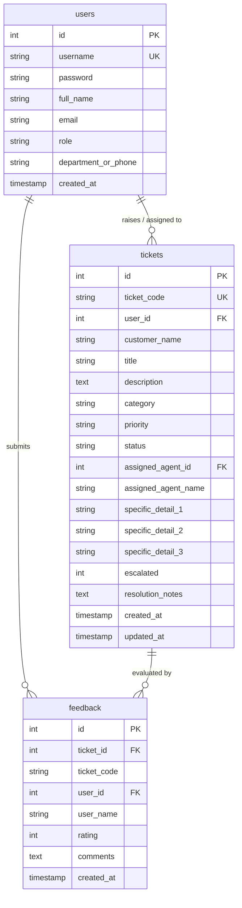

# 🎫 Online Complaint & Helpdesk Management System

<div align="center">


<p align="center">
  <b>A full-featured, enterprise-grade desktop incident logging, ticket dispatch, SLA escalation, and feedback management system built with Core Java, Object-Oriented Design, and JDBC.</b>
</p>

[Key Features](#-key-features) •
[System Architecture](#-system-architecture) •
[OOP Concepts](#-object-oriented-programming-concepts-applied) •
[Installation & Run](#-quick-start--installation) •
[Credentials](#-pre-configured-demo-credentials) •
[Contributors](#-project-team--contributors)

</div>

---

## 📌 Overview

The **Online Complaint and Helpdesk System** is an end-to-end incident management platform developed to streamline service ticket logging, automated assignment, real-time SLA tracking, priority escalation, and customer satisfaction monitoring.

Designed following strict **Object-Oriented Programming (OOP)** paradigms and the **DAO (Data Access Object)** design pattern, the system features a dynamic Java Swing graphical interface powered by a persistent local SQLite database and an autonomous background multithreaded escalation engine.

---

## ✨ Key Features

- **🔐 Multi-Role Access Control**: Separate workflows for Customers/Students (`USER`), Support Engineers (`AGENT`), and System Administrators (`ADMIN`).
- **📝 Dynamic Complaint Categorization**: Dynamic form inputs tailored specifically for:
  - 🖥️ **Hardware Incidents** (Device type, serial number, warranty verification).
  - 💾 **Software Incidents** (Application name, version, operating system environment).
  - 🌐 **Service Requests** (Network, VPN, Wi-Fi, email, lab access, target department).
  - 🏢 **General Inquiries** (Campus blocks, facilities, location details).
- **⏱️ Automated SLA Calculation**: Dynamic service-level agreements computed polymorphically based on incident category and severity.
- **⚡ Multithreaded SLA Escalation Engine**: Dedicated daemon worker thread periodically auditing unresolved complaints and auto-elevating ticket priority (`LOW` ➔ `MEDIUM` ➔ `HIGH` ➔ `CRITICAL`) with real-time UI console streaming.
- **🎯 Dynamic Ticket Assignment**: Allows agents and administrators to delegate tickets to available specialized engineers using the `Assignable` interface.
- **⭐ Customer Feedback & Review Loop**: Customers rate resolution quality (1 to 5 stars) with comments once tickets reach `RESOLVED` or `CLOSED` state.
- **📊 Real-time Dashboard & Filters**: Multi-criteria search, live filtering by category, status, and agent assignment.

---

## 🏗️ System Architecture



---

## 🧩 Object-Oriented Programming Concepts Applied

| OOP Principle / Pattern | Project Implementation |
| :--- | :--- |
| **Encapsulation** | All entities (`User`, `Ticket`, `Feedback`, etc.) feature private attributes exposed safely via validated getters, setters, and parameterized constructors. |
| **Inheritance** | Base abstract class `User` extended by `Customer`, `Agent`, and `Admin`. Base abstract class `Ticket` specialized by `HardwareTicket`, `SoftwareTicket`, `ServiceTicket`, and `GeneralTicket`. |
| **Polymorphism** | Dynamic method dispatch via `calculateSlaHours()`, `getSpecificDetails()`, and `getTicketCategory()`, allowing uniform handling across distinct ticket categories. |
| **Interface Contracts** | The `Assignable` interface decouples ticket assignment behaviors (`assignTo()`, `getAssignedAgent()`, `isAssigned()`, `unassign()`). |
| **Exception Handling** | Custom checked `InvalidTicketException` guards against invalid inputs, empty mandatory fields, and illegal ticket state transitions. |
| **Multithreading** | Autonomous `TicketEscalationService` runs as a background daemon thread implementing `Runnable`, safely synchronizing database audits without freezing the Swing UI. |
| **DAO Pattern** | Complete separation of business logic and SQL persistence through `DBConnection`, `UserDAO`, `TicketDAO`, and `FeedbackDAO`. |

---

## 🗃️ Database Schema

The database runs on SQLite (`helpdesk.db`) and consists of 3 relational tables:



---

## 📂 Project Directory Structure

```plaintext
OOPSProject/
├── lib/                                  # External Dependencies
│   ├── sqlite-jdbc-3.45.1.0.jar          # SQLite JDBC Driver
│   ├── slf4j-api-2.0.9.jar               # SLF4J Core API
│   └── slf4j-simple-2.0.9.jar            # SLF4J Logger Provider
├── src/
│   └── com/helpdesk/
│       ├── Main.java                     # Application Entry Point
│       ├── model/                        # Domain Models & Interfaces
│       │   ├── Assignable.java           # Ticket Assignment Interface
│       │   ├── User.java                 # Abstract User Base Class
│       │   ├── Customer.java             # Customer / Student Model
│       │   ├── Agent.java                # Support Agent Model
│       │   ├── Admin.java                # System Administrator Model
│       │   ├── Ticket.java               # Abstract Ticket Base Class
│       │   ├── HardwareTicket.java       # Hardware Incident Model
│       │   ├── SoftwareTicket.java       # Software Bug / Crash Model
│       │   ├── ServiceTicket.java        # Network / Access Request Model
│       │   ├── GeneralTicket.java        # General Facility Incident Model
│       │   ├── Priority.java             # Priority Levels Enum
│       │   ├── Status.java               # Ticket Lifecycle Status Enum
│       │   └── Feedback.java             # Satisfaction Review Model
│       ├── exception/                    # Custom Exception Handlers
│       │   ├── InvalidTicketException.java
│       │   └── HelpdeskException.java
│       ├── dao/                          # Database Access Layer (JDBC)
│       │   ├── DBConnection.java         # Connection Pooling & Auto-Init
│       │   ├── UserDAO.java              # User Authentication & Persistence
│       │   ├── TicketDAO.java            # Ticket Lifecycle CRUD
│       │   └── FeedbackDAO.java          # Review Ratings Persistence
│       ├── thread/                       # Multithreading & Background Workers
│       │   └── TicketEscalationService.java # Background SLA Monitor Thread
│       └── ui/                           # Graphical User Interface (Swing)
│           ├── UITheme.java              # Palette, Typography & Custom Renderers
│           ├── LoginFrame.java           # Authentication & Registration Window
│           ├── MainDashboard.java        # Main Tabbed Management Window
│           ├── ComplaintSubmissionPanel.java # Dynamic Ticket Logging Panel
│           ├── TicketManagementPanel.java    # Filterable Grid & Action Panel
│           ├── FeedbackPanel.java        # Rating & Satisfaction Dashboard
│           ├── EscalationMonitorPanel.java   # Real-Time Thread Activity Console
│           └── TeamInfoPanel.java        # Architecture & Team Overview
├── schema.sql                            # Standalone SQL Schema DDL
├── helpdesk.db                           # Pre-seeded SQLite Database
├── build_and_run.bat                     # Windows One-Click Compiler & Launcher
├── compile.bat                           # Source Code Compilation Batch
├── run.bat                               # Direct Launcher Batch
└── README.md                             # Project Documentation
```

---

## 🚀 Quick Start & Installation

### Prerequisites
- **Java Development Kit (JDK 17 or higher)** installed and configured in your system `PATH`.
- To verify your Java installation, open a terminal:
  ```bash
  java -version
  javac -version
  ```

---

### Option A: One-Click Execution (Windows)

Simply double-click the included batch scripts:
- **[run.bat](run.bat)**: Launches the pre-compiled application immediately.
- **[build_and_run.bat](build_and_run.bat)**: Recompiles all source files and starts the application.

---

### Option B: Command Line (CMD / PowerShell / Terminal)

1. **Clone the Repository**:
   ```bash
   git clone https://github.com/himanshu931588-cmd/OnlineHelpdeskUsing_JAVA.git
   cd OnlineHelpdeskUsing_JAVA
   ```

2. **Compile the Source Files**:
   ```bash
   # Windows (PowerShell / CMD)
   if not exist bin mkdir bin
   javac -cp "lib/*;src" -d bin src/com/helpdesk/**/*.java src/com/helpdesk/*.java

   # Linux / macOS
   mkdir -p bin
   javac -cp "lib/*:src" -d bin $(find src -name "*.java")
   ```

3. **Launch the Application**:
   ```bash
   # Windows
   java --enable-native-access=ALL-UNNAMED -cp "lib/*;bin" com.helpdesk.Main

   # Linux / macOS
   java --enable-native-access=ALL-UNNAMED -cp "lib/*:bin" com.helpdesk.Main
   ```

---

### Option C: Import into IDE (IntelliJ IDEA / Eclipse / VS Code)

1. Open your IDE and select **Open Project** ➔ Select the `OnlineHelpdeskUsing_JAVA` folder.
2. Add all `.jar` files in the `lib/` directory to the project's **Libraries / Classpath**.
3. Locate `src/com/helpdesk/Main.java`.
4. Right-click and choose **Run 'Main.main()'**.

---

## 🔑 Pre-Configured Demo Credentials

The database is pre-seeded with initial accounts for immediate evaluation:

| Role | Username | Password | Profile / Department |
| :--- | :--- | :--- | :--- |
| **Customer / Student** | `Himanshu` | `user123` | Himanshu (Leader) - Student |
| **Hardware Agent** | `Shubham` | `agent123` | Shubham - Hardware Support |
| **Software Agent** | `Sameer` | `agent123` | Sameer - Software Support |
| **Network & Service Agent**| `khushveer` | `agent123` | Khushveer - Network & Systems |
| **Administrator** | `admin` | `admin123` | System Administrator |

> 💡 *Tip: You can also use the one-click **Quick Demo Login** buttons on the sign-in screen to instantly test different permission levels.*

---

## 👥 Project Team & Contributors

| Name | Role | Student ID |
| :--- | :--- | :--- |
| **Himanshu** **Mishra** | **Project Leader & Lead Developer** | `2510001185` |
| **Shubham** **Kumar** **Singh** | **Core Developer** | `2510001171` |
| **Sameer** **Verma** | **Core Developer** | `2510001164` |
| **Khushvir** **Singh** | **Core Developer** | `2510001153` |

---

## 📄 License

This project is licensed under the **MIT License** — feel free to use and adapt it for learning and academic projects.
